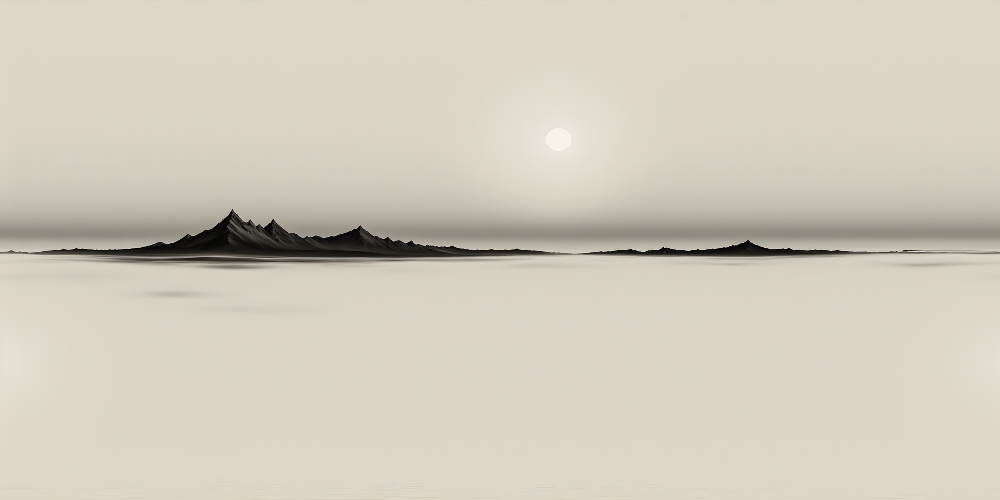

# SOLID_FORMULA

直接由隐式 3D 曲面方程 `f(x,y,z)=0` 生成实体。等值面用 marching cubes 网格化。可选的 `domainHalfSize`（默认 0.5）与 `resolution`（默认 30）控制网格范围与格点密度。关键字 `INSIDE` 反转填充方向，改为网格化曲面的内部。

> `DEF name = SOLID_FORMULA x,y,z equation [domainHalfSize] [resolution] [INSIDE]`

最后一个例子（从球内部看的 `skybox`）贴图取自本文档旁边的 `./black-and-white.png`：`.material(imagePath: "…")` **相对当前 `.md` 场景所在目录**解析，所以图片跟着文档一起走 —— 不需要图床、不涉及 CORS、离线也能用。这是**唯一**的贴图通道：远端 `imageURL:` 写法已删除（远端贴图在 Web 上需要 CORS、而且常常根本连不上 —— 把图片和文档一起发布才是正路），现在写它会直接报错，而不是被静默忽略。

`INSIDE` 曲面**只能从内部**看见，所以天空盒必须把观察者包在里面：这个球半径 3 m，头显场景（原点）与 Web 编辑器的相机（眼高 1.7 m、外移 2 m）都落在球内。半径 1 m 的球会落在那个相机视锥的下方，看起来就像什么也没渲染。



```phymodel

CAD()
.name("sphere")
.mesh(commands: [
    "DEF sphere = SOLID_FORMULA 0,0,0 (x/0.1)^2+(y/0.1)^2+(z/0.1)^2-1=0",
])
.physic(mass: 0.6, staticFriction: 0.6, dynamicFriction: 0.4, restitution: 0.2, mode: .dynamic)
.material(red: 0.67, green: 0.32, blue: 1.0, opacity: 1, roughness: 0.5, metallic: 0.8)
.position(x: 0.5, y: 1.5, z: 0.0)

CAD()
.name("ellipsoid")
.mesh(commands: [
    "DEF ellipsoid = SOLID_FORMULA 0,0,0 (x/0.2)^2+(y/0.1)^2+(z/0.1)^2-1=0",
])
.physic(mass: 0.6, staticFriction: 0.6, dynamicFriction: 0.4, restitution: 0.2, mode: .dynamic)
.material(red: 0.67, green: 0.32, blue: 1.0, opacity: 1, roughness: 0.5, metallic: 0.8)
.position(x: -0.5, y: 1.5, z: 0.0)

CAD()
.name("superquadric")
.mesh(commands: [
    "DEF superquadric = SOLID_FORMULA 0,0,0 (x/0.15)^4+(y/0.15)^4+(z/0.15)^4-1=0 0.5 40",
])
.physic(mass: 0.6, staticFriction: 0.6, dynamicFriction: 0.4, restitution: 0.2, mode: .dynamic)
.material(red: 0.67, green: 0.32, blue: 1.0, opacity: 1, roughness: 0.5, metallic: 0.8)
.position(x: 0.0, y: 1.5, z: 0.0)

CAD()
.name("torus")
.mesh(commands: [
    "DEF torus = SOLID_FORMULA 0,0,0 (x^2+z^2+y^2+0.15^2-0.05^2)^2-4*0.15^2*(x^2+z^2)=0 0.25 48",
])
.physic(mass: 0.3, staticFriction: 0.6, dynamicFriction: 0.4, restitution: 0.2, mode: .dynamic)
.material(red: 0.8, green: 0.2, blue: 0.4, opacity: 1, roughness: 0.5, metallic: 0.8)
.position(x: 0.0, y: 1.0, z: 0.0)

CAD()
.name("skybox")
.mesh(commands: [
    "DEF skybox = SOLID_FORMULA 0,0,0 (x/10)^2+(y/10)^2+(z/10)^2-1=0 INSIDE",
])
.physic(mass: 0.6, staticFriction: 0.6, dynamicFriction: 0.4, restitution: 0.2, mode: .kinematic)
.material(red: 1.00, green: 1.00, blue: 1.00, opacity: 1, roughness: 0.5, metallic: 0.8, imagePath: "./black-and-white.png")
.position(x: 0.0, y: 0.0, z: 0.0)

```
